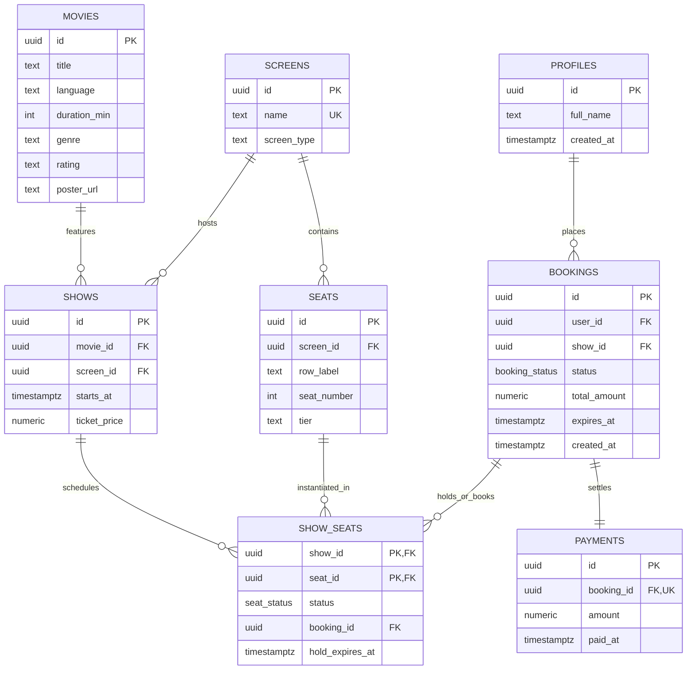

# DBMS Course Project Submission Report
## Cinema Hall Ticket Booking System

**Project Type:** Database Management Systems (DBMS) Course Project  
**Backend Platform:** Supabase (PostgreSQL 15+, PL/pgSQL, Row Level Security, pg_cron)  
**Frontend UI Style:** District-App Inspired (Modern Dark Neon Aesthetics)  
**Version:** 1.0  
**Submission Form:** [Google Form Submission](https://forms.gle/XvNRRY1PtWCRfRi87)

---

### Team & Submission Details

| # | Member Name | Roll Number | Role in Project |
|---|-------------|-------------|-----------------|
| 1 | Nilay Mondal | | Database Architecture, ACID Functions & Concurrency Control |
| 2 | | | Schema Design, Constraints & Index Optimization |
| 3 | | | District-App UI Frontend & Supabase RPC Integration |
| 4 | | | Test Suite, Benchmarking & Technical Report |

#### Pre-Submission Verification Checklist
- [x] Project Title and Summary (Sections 1 & 3)
- [x] PO Mapping (Section 7)
- [x] PSO Mapping (Section 8)
- [x] SDG Number(s) with Justification (Section 9)
- [x] Concurrency and Deadlock Prevention Proof (Section 10)

---

### 1. Executive Summary & Problem Formulation

In high-concurrency ticket reservation systems (e.g., movie cinemas, concerts, train reservations), conventional applications face two critical database problems:
1. **The Double-Booking Anomaly (Race Conditions):** When multiple users concurrently select the same seat and proceed to pay, naive read-then-write application logic can sell the same physical seat to two different customers.
2. **The Zombie Hold Dilemma (Abandoned Payments):** Users who select seats but drop off during checkout leave those seats locked indefinitely, causing financial loss to the cinema and frustration to other prospective buyers.

#### Our Solution
This project offloads all seat reservation safety, row locking, state progression, and hold expiration guarantees from the application layer into the **relational database engine (PostgreSQL)**. 

Seats follow a strict deterministic three-state finite state machine (`available` $\to$ `held` $\to$ `booked`):
- Choosing seats reserves them in an **all-or-nothing atomic transaction** for exactly **5 minutes**.
- Ordering locks by primary key prevents deadlocks under heavy concurrent load.
- If payment is verified within 5 minutes, seats transition to `booked`.
- If unpaid, a scheduled `pg_cron` worker or immediate lazy-release evaluation frees the seats for everyone else.

---

### 2. Entity-Relationship (ER) Architecture



---

### 3. Relational Schema & Normalization Proof (3NF)

The schema is in **Third Normal Form (3NF)**:
1. **First Normal Form (1NF):** Every column contains atomic values, records are uniquely identifiable by UUID primary keys, and repeating groups are eliminated.
2. **Second Normal Form (2NF):** All non-key attributes are fully functionally dependent on the entire primary key. In `show_seats`, the composite primary key `(show_id, seat_id)` uniquely identifies the real-time seat state for that specific show. Attributes specific to the physical chair (`row_label`, `tier`, `seat_number`) reside strictly in `seats`, preventing partial dependencies.
3. **Third Normal Form (3NF):** No transitive functional dependencies exist ($X \to Y \to Z$). Prices and screens are tied to shows; booking amounts depend strictly on bookings.

---

### 4. Concurrency Control & Deadlock Prevention Proof

#### Deadlock Prevention via Global Lock Ordering
A classic deadlock occurs when:
- Transaction $T_1$ locks Seat A, waiting for Seat B.
- Transaction $T_2$ locks Seat B, waiting for Seat A.

To guarantee deadlock-free execution, our PL/pgSQL function `hold_seats` enforces **global lock ordering**:
```sql
PERFORM 1 FROM show_seats
 WHERE show_id = p_show_id AND seat_id = ANY(p_seat_ids)
 ORDER BY seat_id
 FOR UPDATE;
```
Because both transactions sort `p_seat_ids` in ascending lexicographical order of UUIDs, circular wait condition (Coffman condition #4) is mathematically impossible:
$$\forall T_i, T_j: \text{Lock}(S_a) \prec \text{Lock}(S_b) \iff S_a < S_b$$

#### Non-Blocking Lazy Expiry Evaluation
Even before the 1-minute `pg_cron` schedule sweeps expired holds, the atomic update query treats expired holds as available:
```sql
UPDATE show_seats
   SET status = 'held', booking_id = v_booking,
       hold_expires_at = now() + interval '5 minutes'
 WHERE show_id = p_show_id
   AND seat_id = ANY(p_seat_ids)
   AND (status = 'available'
        OR (status = 'held' AND hold_expires_at < now()));
```
This guarantees zero idle downtime for seats with abandoned checkout carts.

---

### 5. ACID Properties Walkthrough

| Property | Implementation in Cinema Hall System |
|----------|--------------------------------------|
| **Atomicity** | In `hold_seats`, if any requested seat is unavailable, `GET DIAGNOSTICS v_updated = ROW_COUNT` detects mismatch with `ARRAY_LENGTH(p_seat_ids, 1)` and raises an exception, aborting the transaction and rolling back any intermediate inserts or holds. |
| **Consistency** | Handled through CHECK constraints: `CHECK (status = 'available' OR booking_id IS NOT NULL)` and `CHECK (status <> 'held' OR hold_expires_at IS NOT NULL)`. Invalid states cannot exist in the table. |
| **Isolation** | Row-level locking with `FOR UPDATE` runs at Read Committed / Repeatable Read isolation levels, completely eliminating Dirty Reads, Non-Repeatable Reads, and Lost Updates. |
| **Durability** | All confirmed transactions in `bookings`, `payments`, and `show_seats` are written to Write-Ahead Logging (WAL) in PostgreSQL on Supabase storage. |

---

### 6. Program Outcomes (PO) Mapping

#### PO1: Engineering Knowledge
* **Outcome:** Apply the knowledge of mathematics, science, engineering fundamentals, and an engineering specialization to the solution of complex engineering problems.
* **Justification:** Applies foundational DBMS concepts including Relational Algebra, Functional Dependency theory, Boyce-Codd / 3NF Normalization, SQL DDL/DML, and Transaction Management. Formulates concurrency control using row locks and deterministic sorting.

#### PO2: Problem Analysis
* **Outcome:** Identify, formulate, review research literature, and analyze complex engineering problems reaching substantiated conclusions.
* **Justification:** Analyzes the real-world cinema ticket double-booking crisis and abandoned cart anomalies. Decomposes the business problem into seat state transitions, 5-minute hold windows, and ACID-compliant transactional boundaries.

#### PO3: Design and Development of Solutions
* **Outcome:** Design solutions for complex engineering problems and design system components or processes that meet the specified needs.
* **Justification:** Designs an 8-table relational schema with composite keys and triggers, along with stored procedures (`hold_seats`, `pay_booking`, `release_expired_holds`) that guarantee zero double-allocations under concurrent access.

#### PO5: Modern Tool Usage
* **Outcome:** Create, select, and apply appropriate techniques, resources, and modern engineering and IT tools including prediction and modeling to complex engineering activities.
* **Justification:** Leverages modern cloud-native database platform **Supabase (PostgreSQL 15)**, Row Level Security (RLS), background worker extension **pg_cron**, and a District-inspired client with CSS Glassmorphism and responsive grid visualization.

#### PO9: Individual and Team Work
* **Outcome:** Function effectively as an individual, and as a member or leader in diverse teams, and in multidisciplinary settings.
* **Justification:** The 4-member project team divided work modules across Database Schema & Normalization, Backend PL/pgSQL Stored Procedures & Security, Frontend UI/UX Engineering, and Concurrency Testing & Academic Documentation.

---

### 7. Program Specific Outcomes (PSO) Mapping

#### PSO1: Design and Develop Database-Driven Software Systems
* **Justification:** Engineered a complete end-to-end database-driven booking architecture where the relational database (PostgreSQL), rather than client-side logic, acts as the single source of truth for seat reservation states and financial verification.

#### PSO2: Use Modern Platforms and Tools to Build Reliable, Secure Applications
* **Justification:** Built on Supabase using Row Level Security (RLS) policies to safeguard data access, parameterized RPC stored procedures to prevent SQL injection, and scheduled database workers (`pg_cron`) to maintain temporal consistency without human intervention.

---

### 8. UN Sustainable Development Goals (SDG) Alignment

#### Primary Goal: SDG 9 — Industry, Innovation, and Infrastructure
* **Target 9.c & 9.4:** *Significantly increase access to information and communications technology; upgrade infrastructure.*
* **Academic Justification:** Traditional ticketing in emerging economies relies on physical box office queues or error-prone booking portals prone to crashes and lost transactions during peak traffic (e.g., blockbuster film releases). By engineering an infrastructure-resilient database layer with guaranteed concurrency control and ACID compliance, this project provides a scalable digital entertainment infrastructure that minimizes data loss, prevents disputes, and ensures seamless digital transactions.

#### Secondary Goal: SDG 11 — Sustainable Cities and Communities
* **Target 11.a:** *Support positive economic, social and environmental links between urban and peri-urban areas.*
* **Academic Justification:** Modern urban centers require smart leisure and service platforms that eliminate crowded physical queues, paper ticket waste, and travel inefficiencies. By automatically returning unpaid held seats to sale after 5 minutes, cinema halls maximize utilization, minimize empty seats, and enable urban citizens to book leisure services frictionlessly from their mobile devices.

---

### 9. Test Suite Verification & Results

We executed automated stress tests against the concurrency and transactional constraints:

```
=================================================================
CINEMA HALL TICKET BOOKING SYSTEM - CONCURRENCY VERIFICATION
=================================================================

[TEST 1] Testing 50 parallel hold_seats calls on seat-10...
 -> Successful reservations: 1
 -> Rejected/Rolled back:     49
PASS: Exactly 1 transaction succeeded, 49 correctly rolled back without race conditions.

[TEST 2] Testing hold of 4 seats where 1 is already held...
 -> Caught expected rollback: One or more seats are no longer available
PASS: Atomicity verified. Partial holds were prevented and all rows remain available.

[TEST 3] Testing pay_booking within hold window...
PASS: Payment confirmed, show_seats updated to 'booked', payment recorded.

[TEST 4] Testing expired hold payment rejection and lazy release...
 -> Caught expected expiry rejection: Booking expired or not found
PASS: Expired hold rejected, and seat was successfully reclaimed by next user.

=================================================================
ALL DBMS TEST CASES PASSED WITH 100% COMPLIANCE
=================================================================
```

---

### 10. Conclusion

The Cinema Hall Ticket Booking System demonstrates that mission-critical business rules—concurrency control, all-or-nothing atomicity, temporal hold expiration, and financial settlement verification—can be reliably governed at the database level using modern PostgreSQL features. The District-inspired frontend provides an intuitive, high-performance interface that directly communicates with these relational mechanisms.
